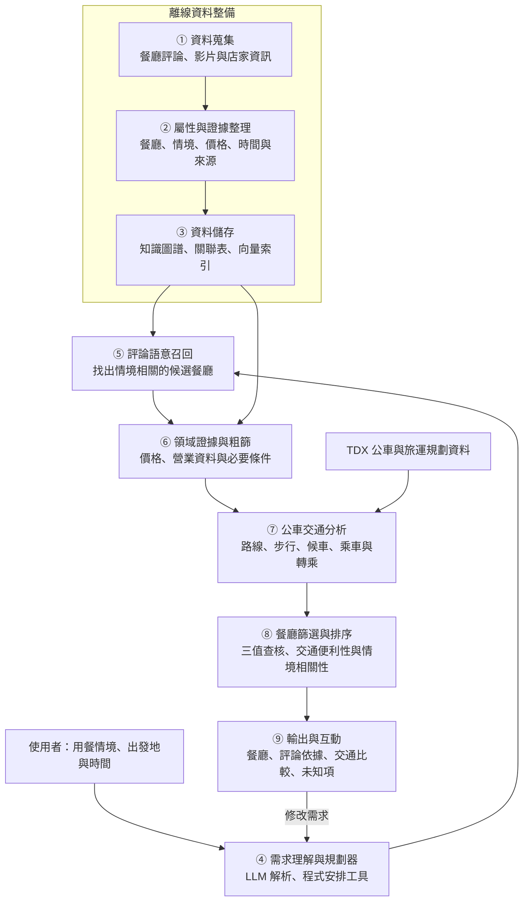
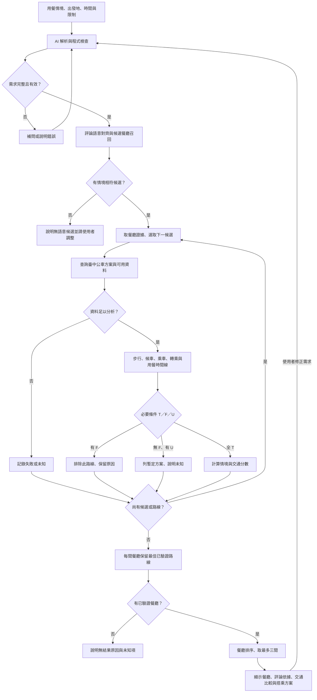

# 考量臺中公車交通便利性的情境感知餐廳推薦

Context-Aware Restaurant Recommendation with Taichung Bus Accessibility

> 修訂文稿，供確認後再同步至 LaTeX。整理日期：2026-10-20。實驗尚未執行，文中尚未實作的設計均為提案。題名為修訂建議，尚未變更原始檔。

## 本次修訂重點（不納入論文正文）

本專案的目的，是幫使用者選餐廳。主流程為：**用餐情境與餐廳評論語意對齊 → 召回候選餐廳 → 查詢臺中公車交通 → 以交通可行性及便利性篩選、排序餐廳 → 顯示推薦理由與搭乘方案。**

餐廳與路線的組合用於計算交通條件，是分析中的中間表示；最終被推薦與排序的對象仍是餐廳。交通方便應影響餐廳選擇，而不是等餐廳排名完成才附一條路線。

| 原稿位置 | 主要調整 |
|---|---|
| 摘要，PDF 第 2 頁 | 依研究動機、問題、方法與預期成果整理；本版暫略評估段，清楚說明評論語意與交通如何接合 |
| 第一章，PDF 第 7–11 頁 | 以使用者選餐廳的問題為主軸，集中研究問題與預期貢獻 |
| 第二章，PDF 第 12–16 頁 | 文獻表採六篇 AI 與六篇領域研究，補入公車規劃與不確定性來源 |
| 第三章，PDF 第 17–19 頁 | 補齊思維模式的證據與設計影響，以及爭論雙方的依據與未決問題 |
| 第四章，PDF 第 20–29 頁 | 釐清先語意召回、再交通篩選；修正上車與轉乘判定，提供編號架構、流程與連續行號演算法 |
| 章節引用與初版範圍 | 評估計畫與研究限制暫不撰寫；行程中監控、延誤重規劃及回程檢查列為後續擴充，不綁入初版驗收 |

本稿保留價格區間中點作顯示與評分、硬預算以區間查核，以及最後點餐未知時只檢查用餐結束不晚於打烊的既有規則。評論來源尚須確認，不直接將 Google 評論設為可長期保存的研究語料。

---

# 摘要

臺中市政府於 2025 年發布的家庭外食分析指出，2024 年底臺中市餐飲業營利事業家數達 22,612 家。對約會、慶生或朋友聚餐的使用者而言，多樣的餐廳選擇除了需要符合用餐情境，也需要實際方便前往。另一方面，近年的規劃研究已將自然語言理解與可驗證的限制處理結合，提供整合用餐需求與交通分析的技術基礎。（[臺中市政府主計處](https://www.dbas.taichung.gov.tw/media/1353434/114-008-快節奏生活下的餐食選擇-臺中市家庭外食特性探析.pdf)；[Hao 等人](https://aclanthology.org/2025.naacl-long.176/)）

然而，評論與用餐情境在語意上相符，不代表餐廳在交通上適合使用者。若餐廳需要長時間候車、步行或多次轉乘，推薦結果可能仍不實用；若在選定餐廳後才附交通路線，交通條件也無法回饋到餐廳的取捨。因此，本研究關注如何在語意候選形成後，將交通可行性與便利性納入餐廳的最終選擇。

為此，本研究提出一個考量臺中公車交通便利性的情境感知餐廳推薦 AI Agent System，先將使用者情境與餐廳評論語意對齊，再取得候選餐廳的公車搭乘方案，篩選並排序最適合的餐廳。

系統以語言模型整理需求，結合向量或混合檢索召回餐廳，以知識圖譜保存餐廳屬性與來源片段，並透過 TDX 取得路線與可用的公車到站資料。分析引擎計算步行、候車、乘車與轉乘負擔，建立抵達及用餐時間線，再以通過、不通過、不確定三值查核預算、營業與搭乘條件。最終輸出餐廳、適合該情境的評論依據、交通比較與搭乘方案；推薦理由依判定紀錄產生。

本研究目前為提案階段，預期建立一個能說明情境依據與交通取捨的餐廳推薦原型，在保留語意相符餐廳的前提下，結合交通篩選與排序，提供適合用餐情境且方便前往的推薦。

關鍵詞：餐廳推薦、評論語意、情境感知推薦、臺中公車、向量檢索、知識圖譜、三值查核。

---

# 第一章 Introduction 緒論

## 1.1 研究背景與動機

外食是日常生活中的重要選擇。臺中市政府於 2025 年發布的家庭外食分析指出，2024 年底臺中市餐飲業營利事業家數達 22,612 家，較 2015 年增加 47.55%。面對多樣的選擇，使用者在約會、慶生或朋友聚餐時，需要知道哪些餐廳符合當次用餐目的。（[臺中市政府主計處](https://www.dbas.taichung.gov.tw/media/1353434/114-008-快節奏生活下的餐食選擇-臺中市家庭外食特性探析.pdf)）

餐廳評論常包含「適合聊天」「氣氛浪漫」「慶生有儀式感」等情境描述。這些語句與使用者需求未必使用相同詞彙，適合透過語意方法找出相關證據。主觀屬性與餐廳對話研究，也說明自然語言偏好與評論片段對推薦的價值。（[Radlinski 等人](https://ojs.aaai.org/index.php/AAAI/article/view/21492)；[Bursztyn 等人](https://aclanthology.org/2021.emnlp-main.145/)）

使用者還需要實際前往餐廳。本研究以臺中市的公車用餐情境為例，考慮從出發地到候選餐廳的步行、候車、乘車與轉乘。臺中市政府於 2026 年發布的運具通報，以 2024 年調查資料指出，男性與女性使用汽車客運的市占率分別為 3.9% 與 6.0%。該類別涵蓋多種客運服務，不直接等同市區公車比例；本研究以公車作為交通分析對象。（[臺中市政府主計處](https://www.dbas.taichung.gov.tw/media/1415735/115-05-運具使用習慣的性別差異.pdf)）

在技術面，自然語言規劃研究已將需求轉換與形式化查核分工，公共運輸研究也以班次、轉乘與步行模型處理旅程。這些方法使系統能在找到語意相關的餐廳之後，進一步比較交通條件，將交通便利性回饋到餐廳的最終推薦。（[Hao 等人](https://aclanthology.org/2025.naacl-long.176/)；[Abuaisha 等人](https://www.ijcai.org/proceedings/2025/937)）

## 1.2 問題陳述與既有方法的不足

以「今晚要和朋友慶生，每人 600 元內，從台中火車站搭公車去」為例，系統首先要理解慶生的情境，從餐廳評論找到有相關依據的候選；接著，才能依使用者的位置與時間安排公車交通，排除不符合條件或交通負擔過大的選擇。

本研究要解決的問題是：如何在保留情境相關性的前提下，利用臺中公車交通條件篩選候選餐廳，使最終推薦同時符合「適合這次用餐」與「方便前往」？當店家或交通資料不足時，又應如何呈現未知項，避免推薦文字承諾超出證據？

只做語意排名，不能保證交通方便；只找交通最近的餐廳，也不能回答約會、慶生等情境需求。既有研究分別提供評論偏好與交通分析方法，本研究將兩者接合成先召回、再交通篩選的流程，並評估交通分析是否實際改變推薦品質。（[Bursztyn 等人](https://aclanthology.org/2021.emnlp-main.145/)；[Abuaisha 等人](https://www.ijcai.org/proceedings/2025/937)）

## 1.3 本研究的方法與創新

為此，本研究提出一個考量臺中公車交通便利性的情境感知餐廳推薦 AI Agent System。語言模型先將自然語言需求整理成情境、預算、出發地、時間及交通限制；檢索模組將情境與餐廳評論語意對齊，召回一批有來源支持的餐廳候選。

對每間候選餐廳，系統再呼叫交通工具取得公車方案，由程式計算步行、候車、乘車與轉乘負擔，檢查抵達後是否仍可完成用餐。明確不符合必要條件者排除；資料不足者標為不確定；通過者再結合情境相關性與交通便利性排序。

本研究的設計差異是讓交通分析在最終選餐廳之前發生，並以可追溯的判定紀錄說明推薦取捨。向量檢索、知識圖譜與公車規劃均有既有方法，本研究不將其個別視為新演算法，而著重於流程整合與本場域的評估。

## 1.4 研究問題

- RQ1：向量或混合檢索是否比關鍵字，更能將約會、慶生等情境與餐廳評論對齊？
- RQ2：在候選形成後加入交通篩選與排序，是否比只依語意排名、最後才補路線，更能兼顧用餐情境與交通便利性？
- RQ3：三值查核與來源、時間紀錄，是否能減少違反必要條件及證據不足卻宣稱符合的情形？
- RQ4：完整時間線是否比只看出發時營業或 API 的單一時間，更能避免無法上車、轉乘不成立與用餐超過打烊？

上述問題用來界定系統設計的重點；評估方法與指標暫不在本稿展開。

## 1.5 預期研究貢獻

1. 建立將用餐情境與餐廳評論語意對齊的候選召回流程，推薦時可回到具體評論依據。
2. 在候選餐廳的最終選擇前加入臺中公車交通分析，比較步行、候車、乘車與轉乘，讓交通便利性影響餐廳排序。
3. 以三值查核及完整時間線處理預算、營業與搭乘條件，區分不符合與證據不足。
4. 提供可回溯評論與交通資料的推薦說明，協助使用者理解餐廳選擇的依據與交通取捨。

## 1.6 論文架構

第二章回顧 AI 技術與餐廳、公車領域研究，整理文獻彙整表與研究缺口。第三章說明五個核心思維模式、三項專業取捨與十個深度理解問題。第四章提出系統架構、資料與時間模型、判定與排序、核心演算法、流程，最後整理預期成果與後續擴充。

---

# 第二章 Related Work 相關研究

## 2.1 AI 技術相關研究

### 2.1.1 自然語言需求與可驗證規劃

TravelPlanner 以 1,225 筆規劃意圖與參考方案評估語言代理，指出多重條件、資訊蒐集與長流程規劃的困難。後續研究將需求轉為形式化限制，再交由求解工具處理，在其 TravelPlanner 設定下達到 93.9% 成功率。這些結果支持將語言理解與限制驗證分工，但不同論文的模型、工具與評估設定必須分開閱讀，不能將他處成功率當成本研究的預期成果。（[Xie 等人](https://proceedings.mlr.press/v235/xie24j.html)；[Hao 等人](https://aclanthology.org/2025.naacl-long.176/)）

TTG 也採取自然語言轉符號表示、再由混合整數線性規劃求解的架構。另一方面，HyperTree Planning 以階層式規劃結構分解任務並反覆修訂，顯示模型端的規劃方式仍可改進。因此，本研究選擇程式化查核，是基於條件需可追溯、規則需一致的設計需求，並不推論所有語言模型規劃皆無效。（[Ju 等人](https://aclanthology.org/2024.emnlp-demo.25/)；[Gui 等人](https://proceedings.mlr.press/v267/gui25b.html)）

### 2.1.2 語意檢索與結構化證據

BRIGHT 將需要推理的檢索需求獨立評測，提醒本研究不能假設語意向量在所有查詢皆優於關鍵字。混合檢索研究則以稀疏與稠密方法的互補性改善檢索。本研究因此比較 BM25、向量與混合召回，讓「適合聚餐」等語意偏好與地名、料理名等明確詞彙皆有相應的檢索方法。（[Su 等人](https://proceedings.iclr.cc/paper_files/paper/2025/hash/7a0f8055c838df8e62329a76c7c6403d-Abstract-Conference.html)；[Lee 等人](https://aclanthology.org/2023.acl-long.746/)）

K-RagRec 使用知識圖譜提供推薦所需的結構化資訊，並在電影與書籍任務中評估推薦表現。本研究借用其「推薦須取得結構化證據」的思路，將圖譜關係設計為餐廳、屬性、來源片段與有效時間；是否需要圖譜，則以相同事實與規則的關聯表版本比較。保存證據與使用圖譜是兩個不同因素，實驗須分別控制。（[Wang 等人](https://aclanthology.org/2025.acl-long.1317/)）

## 2.2 餐廳與公車的領域知識相關研究

### 2.2.1 主觀偏好與用餐情境

餐廳的氛圍、適合對象與用餐目的具有主觀性。主觀屬性研究指出，同一句描述可能依使用者觀點產生不同解讀；餐廳對話研究則將使用者批評轉為正向偏好，再檢索相關評論支持推薦。這些成果支持保留「聚餐」「安靜」等原始語句與來源片段，並容許使用者修正偏好，而不把氛圍標籤當成客觀保證。（[Radlinski 等人](https://ojs.aaai.org/index.php/AAAI/article/view/21492)；[Bursztyn 等人](https://aclanthology.org/2021.emnlp-main.145/)）

在位置與時間方面，餐廳推薦已有將目前位置、請求時間、簽到歷史及人氣整合為分數的研究；STiSAN 也以時空間隔建模下一個地點的選擇。這些方法說明位置與時間會影響推薦，卻不能使「偏好相似」直接等同於「到店後能完成用餐」。本研究將這兩種問題分開：偏好由相關性排序處理，營業與交通則由可行性查核處理。（[Habib 等人](https://ieeexplore.ieee.org/document/7860216)；[Wang 等人](https://ieeexplore.ieee.org/document/9835452)）

### 2.2.2 公車時間、轉乘與動態重規劃

公車可行性須依時間順序處理。到達上車站之前已離站的車輛，不能因為 API 回傳正常狀態而視為可搭乘；轉乘則須先到達前段下車站，完成站間步行與緩衝，才能搭上後段班次。動態重規劃研究以班次、連接段與步行關係描述這些限制，並在 Perth、Berlin、Paris、London 四個運輸網路比較使用者主動請求與系統主動更新的方法。本研究以其中的步行、候車與轉乘模型分析候選餐廳的交通便利性；旅途中重規劃留作後續擴充。（[Abuaisha 等人](https://www.ijcai.org/proceedings/2025/937)）

此外，公車到站時間是預測值。以 Stockholm 公車資料進行的研究，透過 Student-t 模型與貝氏推論表示延誤的不確定性，說明評估不應只關注單一時間預估。本研究不另訓練到站模型，而是保存外部預估的時間依據、加入可調整的緩衝，並將「查核通過」限定為在所採資料與規則下成立。（[Rodriguez-Deniz 與 Villani](https://ieeexplore.ieee.org/document/9714843/)）

TDX 的旅運規劃與公車介面，分別提供路線候選及公車資料。系統實作時須核對站位、方向、子路線、班次可識別性、時間單位與更新欄位，避免只憑路線名稱連結資料。旅運規劃回傳的候選是否有當下可搭乘班次，仍交由後續查核處理。（[TDX 旅運規劃文件](https://tdx.transportdata.tw/api-service/swagger/maas/4513f9d6-caae-4cf7-a50c-e7887bec804e)；[TDX 公車文件](https://tdx.transportdata.tw/api-service/swagger/basic/2998e851-81d0-40f5-b26d-77e2f5ac4118)）

## 2.3 Article Summary Table

表 2.1 將 AI 技術與餐廳、公車領域研究各列六篇。Findings 僅描述原研究；Limitation 中與本研究範圍的差異為本研究之分析，不代表原研究宣稱自己解決失敗。

**表 2.1：Article Summary Table**

| Ref. | Year | Problem | AI Method | Domain Knowledge | Dataset | Findings | Limitation |
|---|---|---|---|---|---|---|---|
| [1] Xie 等人 | 2024 | 多重限制旅遊規劃 | 語言代理與工具使用評測 | 旅遊安排與限制 | TravelPlanner，1,225 筆規劃意圖 | 揭示資訊蒐集與多條件規劃困難 | 非臺中餐廳—公車的動態查核 |
| [2] Hao 等人 | 2025 | 可驗證的限制規劃 | LLM 轉形式化限制，再由求解器處理 | 旅遊條件與不可滿足條件診斷 | TravelPlanner、作者建立的國際旅遊資料 | 其設定下成功率達 93.9% | 求解規則可驗證不等於外部資料必然正確 |
| [3] Ju 等人 | 2024 | 自然語言旅遊需求求解 | 微調 LLM、混合整數線性規劃 | 航班、住宿與景點 | 依真實統計建立的合成資料 | 展示自然語言與符號求解整合 | 未評估本研究的公車到站證據管理 |
| [4] Su 等人 | 2025 | 需要推理的檢索 | BM25、向量等方法評測 | 多領域推理需求 | BRIGHT，1,384 筆查詢 | 顯示推理型檢索仍具挑戰 | 不能由其排名直接推論中文餐廳召回效果 |
| [5] Lee 等人 | 2023 | 稀疏與稠密檢索互補 | 混合檢索訓練目標 | 通用資訊檢索 | MS MARCO、Natural Questions、TREC Robust04 | 互補性目標改善其檢索評測 | 相關性不等於價格、營業與班次可行性 |
| [6] Wang 等人 | 2025 | LLM 推薦的知識支持 | K-RagRec | 電影與書籍推薦 | MovieLens、Amazon Book | 結構化知識改善推薦；另分析虛構項目推薦 | 未測試時間相依的餐廳—公車限制 |
| [7] Radlinski 等人 | 2022 | 主觀屬性的表達 | 概念框架 | 推薦語句的觀點與主觀性 | 無；概念性論述 | 整理主觀屬性問題與研究方向 | 無實驗結果，不能當作效能證據 |
| [8] Bursztyn 等人 | 2021 | 餐廳批評如何轉為偏好 | 語言模型轉換、嵌入與評論排序 | 用餐氛圍與偏好修正 | 餐廳批評與評論資料 | 消融顯示批評轉換可改善其推薦 | 評估偏好支持，未驗證公車可搭乘性 |
| [9] Habib 等人 | 2016 | 位置、時間與偏好的餐廳推薦 | 簽到趨勢與推薦分數建模 | 地理距離、營業時間與人氣 | 線上簽到資料；本稿不新增未核實規模 | 整合位置、時間與偏好產生推薦 | 不能把其推薦分數當成本研究的逐項查核 |
| [10] Wang 等人 | 2022 | 下一個 POI 的推薦 | STiSAN 時空注意力 | 到訪的時空間隔 | Gowalla、Brightkite、Weeplaces、Changchun | 評估時空間隔建模對序列推薦的作用 | 下一地點預測與即時搭乘驗證的任務不同 |
| [11] Abuaisha 等人 | 2025 | 公共運輸中的動態重規劃 | 連接掃描、相關時刻表範圍與 push／pull 更新 | 班次、轉乘、步行與延誤 | Perth、Berlin、Paris、London 的 GTFS 網路 | 動態更新可改善其旅程時間與查詢效率 | 不含餐廳偏好、費用與用餐時間限制 |
| [12] Rodriguez-Deniz 與 Villani | 2022 | 公車延誤與預測不確定性 | Student-t 模型、貝氏推論 | 候車可靠性、時段與站間關係 | Stockholm 高頻公車資料 | 以機率預測表達延誤；其 Student-t 模型優於比較的 Gaussian 模型 | 本研究不具相同訓練資料，不能直接沿用其誤差或機率 |

## 2.4 現有研究、限制與研究缺口

現有研究已提供語意檢索、主觀偏好、時空地點推薦與公共運輸規劃等方法。餐廳情境推薦關心語意是否相符，交通規劃則分析如何抵達；把兩者接起來，還需要決定交通條件如何影響候選餐廳的取捨。（[Bursztyn 等人](https://aclanthology.org/2021.emnlp-main.145/)；[Abuaisha 等人](https://www.ijcai.org/proceedings/2025/937)）

本研究關注的缺口是：在約會、慶生等用餐情境中，先從餐廳評論召回語意相符的候選，再依臺中公車的步行、候車、乘車與轉乘條件篩選餐廳，是否能比只看語意分數提供更合適的最終推薦？此外，若交通或店家證據不足，如何避免把暫時無法判斷的候選當成已確認可行？

本稿的文獻尚不足以回答上述場域問題，因此以相同餐廳候選比較是否加入交通分析，另量測證據查核的作用。研究定位為推薦流程與場域驗證，不以未找到完全相同的題目作為首次提出或既有研究不存在的證明。

---

# 第三章 Deep Research 領域深度研究

## 3.1 五個核心思維模式

本節由餐廳推薦、限制規劃與公共運輸研究整理五種核心思維，分別說明意義、文獻依據及對本系統的影響。

### 3.1.1 先滿足必要條件，再比較偏好

意義是把「想要」與「必須」分開。適合聚餐與偏好某類料理可以比較程度，但超出明確預算或無法完成轉乘，不能靠更高的氛圍分數抵銷。形式化規劃以可滿足條件界定可行解，主觀屬性研究則處理偏好的觀點差異，兩者提供不同性質的決策依據。（[Hao 等人](https://aclanthology.org/2025.naacl-long.176/)；[Radlinski 等人](https://ojs.aaai.org/index.php/AAAI/article/view/21492)）

對系統設計的影響是：硬限制由查核器處理，語意偏好只對可行候選排序；使用者把偏好改成必要條件時，系統也須要求能支持判定的證據。

### 3.1.2 用整條時間線理解旅程

意義是每一段行動都會改變後續事件的可行時間。公車規劃以有順序的連接段與步行段表示轉乘；餐廳推薦也已將時間與位置納入模型。依此推論，餐廳營業查核應使用走完交通流程後的抵達與離店時間。（[Abuaisha 等人](https://www.ijcai.org/proceedings/2025/937)；[Habib 等人](https://ieeexplore.ieee.org/document/7860216)）

對系統設計的影響是：不能在取得路線前就完成營業與步行驗證；當即時候車時間改變時，後續抵達、用餐結束與所需回程也須重新計算。

### 3.1.3 預估值與證據不足分開處理

意義是「有一個數字」不等於「這個數字準確」，「沒有數字」也不等於服務不存在。公車機率預測研究直接建模延誤分布，證明不確定性是需要處理的研究對象。三值查核則是本研究對證據是否足夠的設計，兩者不能混為同一種機率。（[Rodriguez-Deniz 與 Villani](https://ieeexplore.ieee.org/document/9714843/)）

對系統設計的影響是：資料缺漏、時間依據不足或班次無法對齊時判為不確定；即使通過，仍顯示預估時間與採用的緩衝，不輸出尚未驗證的成功機率。

### 3.1.4 推薦理由須回到具體依據

意義是分清店家事實、主觀描述與系統推算。餐廳對話研究透過評論片段支持偏好推薦，圖譜增強推薦則使用結構化知識協助模型。本研究據此要求每一項推薦聲明可回溯至來源或計算紀錄。（[Bursztyn 等人](https://aclanthology.org/2021.emnlp-main.145/)；[Wang 等人](https://aclanthology.org/2025.acl-long.1317/)）

對系統設計的影響是：營業事實與來源的發布、觀測、取得時間分別保存；推薦理由只能讀取判定紀錄。影片發布日期不被當作店家資訊仍有效的證明。

### 3.1.5 餐廳選擇與到達方式須一起評估

意義是交通不是選完餐廳後才補上的附註。時空地點推薦與公共運輸研究分別說明位置、時間及轉乘關係的重要性；本研究由此推論，交通條件應在候選餐廳的最終排名前評估。（[Wang 等人](https://ieeexplore.ieee.org/document/9835452)；[Abuaisha 等人](https://www.ijcai.org/proceedings/2025/937)）

對系統設計的影響是：先找出情境相符的餐廳集合，再對每間取得公車方案，排除不符合必要條件者，並將交通負擔納入餐廳排序。交通方便不能挽救明顯不符合情境的餐廳；同樣地，高語意分數也不能抵銷不可搭乘的路線。

## 3.2 三項專業爭論與設計取捨

### 3.2.1 時刻表規劃 ↔ 持續使用即時資訊

**觀點 A。** 時刻表提供未來服務與完整旅程的基礎，適合處理超出即時預估範圍的行程。動態重規劃研究也以時刻表網路作為計算基礎，並未以即時資訊取代全部靜態資料。

**觀點 B。** 僅靠出發前的時刻表或單次快照，不能回應後續延誤與新出現的替代路線；系統主動更新可減少使用者反覆自行查詢的負擔。

**Evidence。** 動態重規劃研究直接比較歷史備案、單次快照與持續更新的差異，並分析 push 與 pull 方法的效能。它同時說明更新帶來的查詢與計算成本。（[Abuaisha 等人](https://www.ijcai.org/proceedings/2025/937)）

**Consensus。** 就該研究可支持的共同基礎而言，班表與即時資訊各有用途；不能因此推論臺中所有路線的更新頻率或資料品質相同。

**Unresolved Problems。** 本場域的即時覆蓋、更新間隔與 API 成本仍須量測。本研究將班表用於路線候選，將即時資料用於可取得時間範圍內的查核；持續監控列為擴充方向。

### 3.2.2 最早抵達 ↔ 保留較大的可靠性餘裕

**觀點 A。** 以最早抵達作目標，能直接比較旅程時間；動態重規劃亦可能找到比原路線更早到達的行動。

**觀點 B。** 對轉乘餘裕很小的方案，單一預估時間可能低估失敗風險。公車延誤的機率模型顯示，平均或點估計之外，仍需要關注預測分布。

**Evidence。** 前者以動態路線的抵達時間評估，後者以公車延誤與預測分布評估；兩者提供不同決策目標的依據，並非同一實驗中的直接勝負比較。（[Abuaisha 等人](https://www.ijcai.org/proceedings/2025/937)；[Rodriguez-Deniz 與 Villani](https://ieeexplore.ieee.org/document/9714843/)）

**Consensus。** 可歸納的共同點是旅程時間與不確定性皆需呈現；現有證據不足以支持一個對所有使用者皆最佳的固定緩衝值。

**Unresolved Problems。** 緩衝過大可能排除可搭乘方案，過小又可能增加接不上車的情形。本研究以開發資料設定緩衝，測試不同設定下的違反率、覆蓋率與旅程時間，正式測試前凍結參數。

### 3.2.3 以語言模型持續規劃 ↔ 以形式化工具驗證條件

**觀點 A。** 語言模型可依自然語言需求分解任務並修訂計畫，較容易表達複雜情境；階層式規劃研究顯示這條路線仍可改善。

**觀點 B。** 對預算、時間與轉乘等明確條件，形式化工具可提供可重複檢查的判定與失敗理由。

**Evidence。** HyperTree Planning 研究模型規劃結構，形式化規劃研究則將限制交由求解器處理；兩者皆在各自設定中報告效果。本研究不跨論文直接比較其成功率。（[Gui 等人](https://proceedings.mlr.press/v267/gui25b.html)；[Hao 等人](https://aclanthology.org/2025.naacl-long.176/)）

**Consensus。** 兩類研究均需評估是否滿足需求；文獻不足以證明單一架構在本場域必然最佳。本系統採語言理解與程式查核分工，屬本研究可被驗證的設計選擇。

**Unresolved Problems。** 需求若在入口被解析錯誤，後續程式即使正確，也只是在驗證錯誤的條件。因此實驗須另量測需求欄位解析，並比較相同資料下的模型排名與受控查核。

## 3.3 十個深度理解問題

| 類型 | 問題 | 應能推理的重點 |
|---|---|---|
| Why | 為何營業查核要使用抵達與離店時間，而不是查詢時間？ | 候車與轉乘改變後續時間；需覆蓋用餐區間 |
| Failure case | 預估 18:50 抵達、19:00 打烊，用餐需 90 分鐘，應如何判定？ | 抵達時有開門仍不足；用餐結束超過打烊為不通過；數字為設計示例 |
| What-if | 公車預估 3 分鐘到站，使用者走到站牌需 6 分鐘，且這是最後一班時，能否推薦？ | 正常狀態與 ETA 存在不代表能搭上；須比較準備時間與班次 |
| Trade-off | 增加轉乘緩衝後錯誤減少，但已驗證覆蓋也大幅下降，能否稱為改善？ | 同時報告風險與覆蓋，並比較旅程成本 |
| Evidence | 兩個來源對營業時間不同，應依什麼資訊決定可用證據？ | 來源、適用日期、核對時間、版本與衝突；不能單看抓取時間 |
| Comparison | 若 TDX 與另一服務的 ETA 不同，如何判斷誰較準？ | 同站位、方向、班次、觀測時點對齊，另取實際到站紀錄 |
| Design decision | 圖譜與 SQL 保存相同事實時，圖譜仍可能有什麼價值？ | 證據路徑、查詢正確性、延遲與維護成本；不能預設推薦一定更好 |
| Real-world scenario | 已上車後轉乘取消，為何不能仍以原出發地規劃？ | 行程狀態、當前可下車站與新時間；此為後續動態擴充應處理的情境 |
| Counterexample | 所有查詢都不回傳方案，限制違反率很低，是否代表可靠？ | 零分母不能記為零錯誤；須看拒答、覆蓋與假性無解 |
| Evaluation | 只重播 N1 紀錄，能否證明推薦降低實際錯過公車的比例？ | 可以驗證資訊變動與處理流程；實際到站與反事實效果須有額外證據 |

---

# 第四章 Proposed Scheme 研究方法與系統設計

## 4.1 問題定義與需求結構

系統輸入為使用者的自然語言需求、出發位置與時間，輸出為最多三間不同餐廳，以及各自的情境依據與建議公車方案。最終決策對象是餐廳；同一餐廳可能有不同路線，系統先找出合適路線，再以交通條件回饋餐廳排序。

需求分為語意偏好、必要限制與動態狀態。「適合約會」「慶生」用於評論語意召回；預算、步行上限與最多可轉乘次數作為必要條件；公車 ETA、抵達時間與營業狀態則隨查詢時間分析。相對時間須轉為具體日期與時刻，預算也須區分每人與整團；關鍵欄位不明時先補問。

為分析交通，暫以 z = (r, p) 表示餐廳 r 與公車方案 p 的組合。這個表示用於計算與查核，不代表餐廳與交通是兩個同等的推薦目的。原始評論、影片與網頁一律視為資料，不得改變系統規則。

## 4.2 設計原則

第一，先找情境相符的餐廳，再安排交通，避免因為交通方便而推薦明顯不符情境的餐廳。第二，在最終排名前分析交通，避免只在既定餐廳後附一條路線。第三，必要限制由程式查核，較高語意分數不能抵銷明確不符合的預算或搭乘條件。第四，來源不足時表達不確定，不把資料缺漏當成已確認可行。第五，推薦說明須能回到評論、資料與判定紀錄。

初版以查詢當下的餐廳推薦與交通比較為核心，行程中監控、延誤重規劃與回程檢查列於 4.10 節的後續擴充。

## 4.3 系統架構

圖 4.1 由九個編號模組組成。①–③ 為離線資料整備，④–⑨ 為線上推薦流程。

**圖 4.1：系統架構圖**



① 蒐集可用的餐廳評論、影片逐字稿與店家資訊。② 整理餐廳實體、分店、情境片段、價格與營業資料，保存來源並人工核對。③ 將文字片段存入向量索引，將餐廳、屬性與證據關係存入圖譜及關聯表。

④ 語言模型將需求轉為固定欄位；程式化規劃器檢查輸入、安排工具並處理失敗。⑤ 以關鍵字、向量或混合方法對齊情境與評論，按餐廳去重形成候選集合。⑥ 查詢相關證據，先排除已知預算等非路線條件不符者；完整營業與步行判定留待交通資料取得後處理。

⑦ 以出發地、時間及餐廳位置取得公車候選，分析步行、候車、乘車與轉乘時間。⑧ 對餐廳—路線組合查核，排除明確不符者，未知者另列；為每間餐廳保留合適方案，再結合語意與交通排序。⑨ 顯示餐廳、評論語意依據、交通負擔與來源；使用者可修正情境或交通條件，重新進入相同流程。

## 4.4 資料來源與品質控管

**表 4.1：資料來源與用途**

| 資料 | 預計來源 | 用途與核對方式 |
|---|---|---|
| 餐廳評論與情境描述 | 可合法取得的評論資料；原稿規劃的 YouTube 逐字稿與留言可作補充 | 以文字片段對齊約會、慶生等情境；保存餐廳 ID、來源與片段，不把主觀描述當成事實保證 |
| 餐廳名稱與分店 | 店家公開資訊、人工核對；Places API 協助地點對應 | 同名或多分店時保留核對，不只靠名稱合併 |
| 營業時段與價格 | 店家官方資訊及必要的人工核對 | 保存核對日期、適用日期與原始價格區間 |
| 餐廳座標 | 可追溯的位置資料或現場核對 | 用於路線查詢；Place ID 不能代替座標 |
| 公車搭乘方案 | TDX 旅運規劃 | 取得各候選餐廳的公車與步行路線，再分析條件 |
| 公車 ETA 與狀態 | TDX 預估到站 N1 | 查核當下可取得的上車與轉乘依據 |
| 站位、路線、班表與站間時間 | TDX 公車資料 | 核對方向、站序、服務日及未來服務，區分班表與即時依據 |

評論是本研究的核心語意資料。原稿已有影片逐字稿與留言規劃，本稿保留其作為補充來源；正式評論來源與可使用範圍須先確認，不能把影片敘述、觀眾留言與到店評論混作同一種證據。資料須標明文字類型，保留各自的來源與用途。

每筆文字與事實保存來源 ID、可得的發布時間、觀測或更新時間、本系統取得時間及適用日期。缺少時間欄位時保留空值，不以抓取時間冒充來源更新時間；影片發布日期也不能證明店家價格至今未變。

Places API 本稿僅規劃作地點對應並持久保存 Place ID；不預設可以大量保存其評論建立向量語料。若評論來源改用平台 API，須先核對適用的保存、索引與展示政策，再確認設計。（[Google Places API 政策](https://developers.google.com/maps/documentation/places/web-service/policies)）

每項判定另存 restaurant_id、plan_id、constraint_id、T／F／U、reason、evidence_ids 與判定時點。圖譜支援餐廳、情境屬性及來源片段的查詢，向量索引負責語意召回；兩者功能不混為「使用圖譜就代表事實正確」。

## 4.5 可行性判定與時間模型

### 4.5.1 三值判定

對每項必要限制，T 表示在可用證據與規則下通過，F 表示已知不符合，U 表示不足以判斷。任一項 F 則排除該餐廳—路線組合；全為 T 才進入已驗證排序；沒有 F 但有 U 則列入暫定區。某餐廳的一條路線不符合時，仍可檢查其他允許路線，不能立即排除整間餐廳。

| 限制 | 通過 T | 不通過 F | 不確定 U |
|---|---|---|---|
| 餐費預算 | 價格區間上界不超過同單位預算 | 區間下界已超過預算 | 價格不明、單位不明或區間跨預算 |
| 營業時間 | 抵達與預計離店皆落在同一有效營業區間 | 抵達或用餐區間已知不符 | 缺時段、抵達或必要用餐時間 |
| 步行上限 | 所有必要步行段符合使用者指定的上限定義 | 至少一段已知超過 | 缺步行路段或時間 |
| 上車班次 | 可在班次到站前完成步行與緩衝，且符合候車上限 | 已知允許的班次皆趕不上或服務不符 | ETA 過期、時間依據不足或班次無法對齊 |
| 轉乘與次數 | 次數符合，前段到達加步行與緩衝仍接得上後段 | 已知超過次數或允許範圍內皆接不上 | 後段只有班距或時間無法確認 |

最後點餐時間若已知，依該時間檢查；若未知，沿用只檢查用餐結束不晚於打烊的規則，並揭露未確認。一般情境不因最後點餐未提供而額外推翻既定規則；若使用者明確要求確認可點餐，則另作必要限制並判 U。

### 4.5.2 上車與轉乘

令 t_ready 為到達上車站並完成緩衝的時間，t_bus 為對齊後的預估到站或可用發車時間，W_max 為候車上限，上車須符合式 4.1。

**式 4.1**

    t_ready = t_dep + T_walk_to_stop + b_board
    t_ready ≤ t_bus ≤ t_ready + W_max

轉乘第 i 段時，令 a_i 為前段抵達，w_i 為轉乘步行，b_i 為緩衝，d_(i+1) 為後段可用發車時間，須符合式 4.2。

**式 4.2**

    a_i + w_i + b_i ≤ d_(i+1)

正常狀態與 EstimateTime 有值只是判定輸入，不能單獨當作可搭乘。尚未發車也不一律當作 F，須再看可用發車時間。路線、子路線、方向、站位與必要站序須對齊；時間為倒數值時，須有可確認的參考時刻，才能換算與使用者時間比較。

### 4.5.3 抵達與用餐

交通分析串接步行、候車、乘車、轉乘與最後步行，得到抵達時間，再加入用餐時長。若即時候車或轉乘更新，後續抵達及離店時間須重算；API 已包含的路段時間不能重複相加。

**式 4.3**

    t_arr(r,p) = t_dep + T_initial_walk
                 + Σ(T_wait,i + T_ride,i)
                 + Σ(T_transfer_walk,i) + T_final_walk
    t_leave(r,p) = t_arr(r,p) + D_meal

D_meal 優先由使用者提供；若採 90–120 分鐘為預設假設，這是計畫值，須清楚顯示並可修改。營業查核使用完整用餐區間，跨日與午晚餐分段先轉為帶日期的區間。

## 4.6 餐廳排序與交通便利性

交通便利性由步行、候車、乘車與轉乘負擔表示，與語意相關性分開計算。先排除必要條件不符的路線，為每間候選餐廳保留合適方案，再對餐廳排序，避免多條路線使同一間餐廳重複占據結果。

沿用原稿的加分與扣分架構，組合分數與餐廳分數如式 4.4。p*(r) 是餐廳 r 在可通過路線中的最佳方案；最終按 S_restaurant 排餐廳，不輸出只有交通相近卻缺乏情境依據的店家。

**式 4.4**

    S(r,p|q) = α s_sem + β s_ctx − γ c_food − δ u_walk
               − ε u_wait − ζ u_ride_transfer − η u_evid
    p*(r) = argmax over verified plans p of S(r,p|q)
    S_restaurant(r|q) = S(r,p*(r)|q)

各項用開發資料決定的固定尺度轉為 0–1，權重非負且總和為 1，正式測試前凍結。u_ride_transfer 將乘車時間與轉乘負擔分開計算後依固定規則合成，避免只用總時間掩蓋多次轉乘。尺度、權重與語意召回門檻須記錄，不預先宣稱某組數值最好。

餐費估計沿用價格區間中點，僅供顯示與評分；硬預算仍以區間查核，跨預算為 U。u_evid 只比較仍足以查核的證據品質，必要證據缺漏者不得靠小幅扣分留在已驗證排序。輸出最多三間餐廳，同分以固定 ID 排序。

## 4.7 核心演算法

**Algorithm 4.1：Context-first restaurant recommendation with bus analysis**

```text
Input : User query Q, origin O, departure time t_dep
Output: Restaurants R, bus plans P, evidence and unknown items D

01: intent ← PARSE_WITH_SCHEMA(Q)
02: if required fields are missing: return ASK_USER(intent)
03: if units or values are invalid: return EXPLAIN_INPUT_ERROR
04: candidates ← RETRIEVE_CONTEXT_MATCHED_RESTAURANTS(intent)
05: candidates ← DEDUPLICATE_BY_RESTAURANT(candidates)
06: if candidates is empty: return EXPLAIN_NO_CONTEXT_MATCH
07: evidence ← RETRIEVE_CONTEXT_AND_DOMAIN_EVIDENCE(candidates)
08: C ← TOP_K(REMOVE_CONFIRMED_STATIC_FAILURES(candidates, evidence))
09: verified, provisional, records ← empty collections
10: for each restaurant r in C:
11:     plans, tool_status ← GET_BUS_PLANS(O, r, t_dep)
12:     if tool_status cannot establish usable plans:
13:         RECORD_FAILURE_OR_UNKNOWN(r, tool_status, records); continue
14:     for each plan p in plans:
15:         bus_data ← FETCH_AND_ALIGN_RELEVANT_BUS_DATA(p)
16:         timeline ← BUILD_UPDATED_TIMELINE(r, p, intent, bus_data)
17:         h ← CHECK_REQUIRED_CONSTRAINTS(r, p, timeline, evidence)
18:         record ← SAVE_DECISION(r, p, h, timeline, evidence, bus_data)
19:         records.append(record)
20:         if ANY_FALSE(h): continue
21:         if ANY_UNKNOWN(h): provisional.append(r, p, record); continue
22:         verified.append(r, p, SCORE_CONTEXT_AND_TRANSPORT(record))
23: best_plan_per_restaurant ← KEEP_BEST_VERIFIED_PLAN(verified)
24: R ← TOP_3_RESTAURANTS(STABLE_SORT(best_plan_per_restaurant))
25: if R is empty: return NO_VERIFIED_RESULT(provisional, records)
26: explanation ← GENERATE_FROM_RECORDS(R, records)
27: if explanation fails fact checks: explanation ← TEMPLATE(R, records)
28: return R, corresponding bus plans, explanation, provisional, records
```

路線查詢失敗與已知無服務分開記錄；未取得回應不直接等於證明無路線。所有候選完成後，才判斷是否沒有已驗證餐廳。使用者要放寬預算或步行限制時，須明確修改需求，系統不靜默放寬。

## 4.8 決策流程

**圖 4.2：決策流程圖**



流程先完成情境召回，再分析公車，最後排餐廳。某一條路線失敗不立即終止其他候選；未知資料也有獨立輸出，不混在已確認符合的結果。

## 4.9 預期成果

預期交付能理解用餐情境、召回相關餐廳、比較臺中公車交通並產生最終推薦的原型，輸出包含評論依據、價格、用餐時間、交通負擔、搭乘方案與未知項。另提供可回溯來源的候選餐廳、交通分析與查核紀錄。

預期系統能在情境相符的候選中，利用公車交通分析協助使用者取捨，並透過三值與時間查核呈現可判斷與未知的條件。以上為預期方向，尚非實驗結果。

## 4.10 後續擴充

完成初版並確認資料可用後，可延伸到出發後監控、延誤時重排與替代餐廳提醒，以及用餐結束後的回程。這些功能需要額外的行程狀態、位置、通知與未來班次證據，不列入初版核心驗收。

若實作監控，須以同一可識別班次的絕對預估時刻比較延誤，上車後仍監控剩餘路段，資料失效時撤除受影響的通過聲明。替代餐廳不自動覆寫使用者已選的目的地。若處理回程，不能把起站末班發車直接當成使用者上車站的時間，也不能只檢查用餐時長區間的兩個端點就保證整段皆可行。這些均須另訂規格與評估後才納入。

---

# 參考資料

以下編號供文獻表核對。正文以作者名稱連結來源；年份與出版資訊集中列於此處及文獻表。

1. Xie, J., et al. (2024). *TravelPlanner: A Benchmark for Real-World Planning with Language Agents*. ICML, PMLR 235, 54590–54613. [原始來源](https://proceedings.mlr.press/v235/xie24j.html)。
2. Hao, Y., Chen, Y., Zhang, Y., & Fan, C. (2025). *Large Language Models Can Solve Real-World Planning Rigorously with Formal Verification Tools*. NAACL, 3434–3483. [原始來源](https://aclanthology.org/2025.naacl-long.176/)。
3. Ju, D., et al. (2024). *To the Globe (TTG): Towards Language-Driven Guaranteed Travel Planning*. EMNLP System Demonstrations, 240–249. [原始來源](https://aclanthology.org/2024.emnlp-demo.25/)。
4. Su, H., et al. (2025). *BRIGHT: A Realistic and Challenging Benchmark for Reasoning-Intensive Retrieval*. ICLR. [原始來源](https://proceedings.iclr.cc/paper_files/paper/2025/hash/7a0f8055c838df8e62329a76c7c6403d-Abstract-Conference.html)。
5. Lee, D., Hwang, S., Lee, K., Choi, S., & Park, S. (2023). *On Complementarity Objectives for Hybrid Retrieval*. ACL, 13357–13368. [原始來源](https://aclanthology.org/2023.acl-long.746/)。
6. Wang, S., et al. (2025). *Knowledge Graph Retrieval-Augmented Generation for LLM-based Recommendation*. ACL, 27152–27168. [原始來源](https://aclanthology.org/2025.acl-long.1317/)。
7. Radlinski, F., Boutilier, C., Ramachandran, D., & Vendrov, I. (2022). *Subjective Attributes in Conversational Recommendation Systems: Challenges and Opportunities*. AAAI, 36(11), 12287–12293. [原始來源](https://ojs.aaai.org/index.php/AAAI/article/view/21492)。
8. Bursztyn, V., et al. (2021). *“It doesn’t look good for a date”: Transforming Critiques into Preferences for Conversational Recommendation Systems*. EMNLP, 1913–1918. [原始來源](https://aclanthology.org/2021.emnlp-main.145/)。
9. Habib, M. A., Rakib, M. A., & Hasan, M. A. (2016). *Location, Time, and Preference Aware Restaurant Recommendation Method*. IEEE ICCIT, 315–320. [原始來源](https://ieeexplore.ieee.org/document/7860216)。
10. Wang, E., Jiang, Y., Xu, Y., Wang, L., & Yang, Y. (2022). *Spatial-Temporal Interval Aware Sequential POI Recommendation*. IEEE ICDE, 2086–2098. [原始來源](https://ieeexplore.ieee.org/document/9835452)；[作者提供全文](https://micxyb.github.io/papers/Spatial-Temporal_Interval_Aware_Sequential_POI_Recommendation.pdf)。
11. Abuaisha, A., Shen, B., Harabor, D. D., Stuckey, P. J., & Wallace, M. (2025). *Dynamic Replanning for Improved Public Transport Routing*. IJCAI, 8430–8437. [原始來源](https://www.ijcai.org/proceedings/2025/937)。
12. Rodriguez-Deniz, H., & Villani, M. (2022). *Robust Real-Time Delay Predictions in a Network of High-Frequency Urban Buses*. IEEE Transactions on Intelligent Transportation Systems, 23(9), 16304–16317. [原始來源](https://ieeexplore.ieee.org/document/9714843/)；DOI：10.1109/TITS.2022.3149656。
13. Gui, R., et al. (2025). *HyperTree Planning: Enhancing LLM Reasoning via Hierarchical Thinking*. ICML, PMLR 267, 20694–20722. [原始來源](https://proceedings.mlr.press/v267/gui25b.html)。
14. 臺中市政府主計處（2025 年 12 月）。*快節奏生活下的餐食選擇——臺中市家庭外食特性探析*。使用 2024 年統計資料。[政府原始報告](https://www.dbas.taichung.gov.tw/media/1353434/114-008-快節奏生活下的餐食選擇-臺中市家庭外食特性探析.pdf)。
15. 臺中市政府主計處（2026 年 5 月）。*運具使用習慣的性別差異*。使用 2024 年調查資料。[政府原始報告](https://www.dbas.taichung.gov.tw/media/1415735/115-05-運具使用習慣的性別差異.pdf)。
16. 交通部 TDX。*公共運輸旅運規劃功能模組 API 文件*。[官方文件](https://tdx.transportdata.tw/api-service/swagger/maas/4513f9d6-caae-4cf7-a50c-e7887bec804e)。
17. 交通部 TDX。*公共運輸—公車 API 文件*。[官方文件](https://tdx.transportdata.tw/api-service/swagger/basic/2998e851-81d0-40f5-b26d-77e2f5ac4118)。
18. Google。*Policies and Attributions for Places API*。[官方文件](https://developers.google.com/maps/documentation/places/web-service/policies)。


# 待確認後才同步的事項（不納入論文正文）

| 項目 | 本稿處理 | 定稿後動作 |
|---|---|---|
| 核心目標 | 評論情境召回後，以臺中公車交通篩選與排序餐廳 | 摘要、各章、圖、表與演算法一起同步 |
| 初版範圍 | 查詢時的餐廳與公車方案推薦；監控、延誤重規劃與回程列為後續擴充 | 登錄本專案的範圍決策，避免舊文仍寫成全部已納入 |
| 評論資料 | 核心來源待確認，影片與留言可作補充；不預設保存平台評論 | 核對來源、授權、可保存欄位與情境標註方式 |
| 評估與研究限制 | 依目前撰寫範圍先不展開 | 後續需要時再補；不自行變更 main.tex 或解除第五、六章註解 |
| 原有判定 | 中點僅供顯示與評分；硬預算用區間；最後點餐未知採既有用餐結束規則 | 不改既有決議；若要改規則，先新增決策紀錄 |
| 設計文件 | 本專案目前未有 design.md、specs/spec.md | 以本專案檔案為準，不沿用其他專案的文件或決策編號 |
| LaTeX | 本次未修改任何 LaTeX 檔案 | 文稿確認後只改 abs/、alg/、bib/、chapters/、figures/、tables/ |
